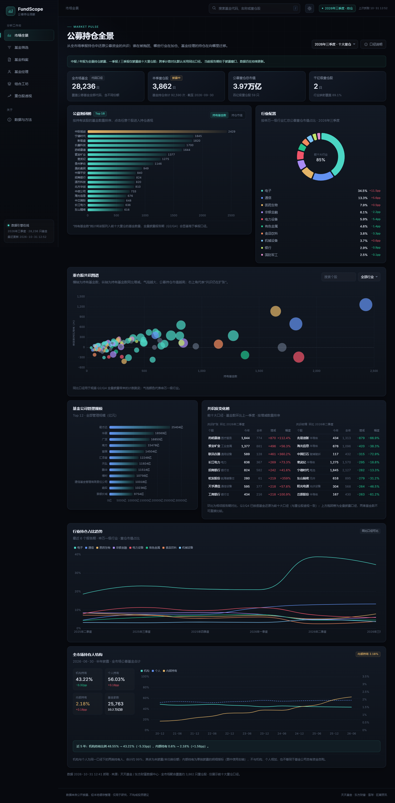
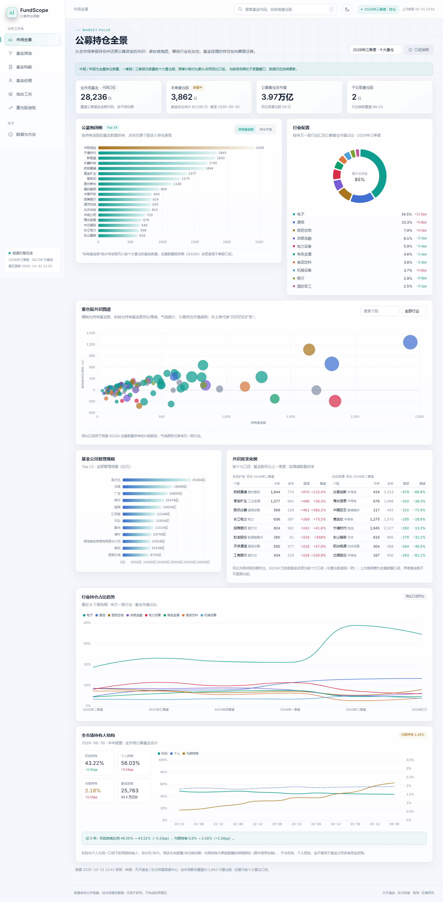

# FundScope · 中国公募基金持仓分析看板

一个本地运行、可审计、可缓存的公募基金研究工作台。它不做净值预测，也不推荐买卖，而是把公开披露的季报数据整理成可验证的结构：

- 公募整体在**抱团什么**、哪些行业正在被加仓；
- 单只基金的**前十大重仓**、行业暴露、规模与持有人结构；
- **机构 / 个人 / 内部持有**的变化，以及内部持有作为“自购代理指标”的信号；
- 把多只基金**穿透到底层股票**，看组合是真的分散，还是“换了个名字的同一篮子股票”；
- 从个股反查**多少只基金把它买进前十大**，以及共识在扩张还是瓦解。

> 数据来自公开披露，存在滞后与口径差异。仅用于研究，不构成投资建议。

<p align="center">
  
  
</p>
<p align="center"><sub>深色 / 浅色双主题 · 顶栏右侧一键切换</sub></p>

更多截图：[基金档案](docs/screenshots/fund.png) · [基金经理](docs/screenshots/managers.png) · [基金筛选](docs/screenshots/screener.png) · [组合工坊](docs/screenshots/portfolio.png) · [重仓股透视](docs/screenshots/stocks.png)

浅色模式：[基金档案](docs/screenshots/fund-light.png) · [基金经理](docs/screenshots/managers-light.png) · [基金筛选](docs/screenshots/screener-light.png) · [组合工坊](docs/screenshots/portfolio-light.png) · [重仓股透视](docs/screenshots/stocks-light.png)

---

## 功能

| 模块 | 你能看到什么 |
| --- | --- |
| **市场全景** | 全市场基金重仓股聚合、公募抱团榜、申万一级行业配置、重仓股共识气泡图、基金公司规模、持有基金数环比增减榜（前十大口径）、行业占比趋势、全市场持有人结构 |
| **基金筛选** | 2 万余只基金；除收益/评级/费率外，新增**规模、机构占比、内部持有、经理年限、经理在管规模、成立年限**等维度；**4433 法则**标记；持有人快照覆盖 2,790 只，桌面表格与移动端卡片式布局 |
| **基金档案** | 区间累计收益率（起点 0%）与**按区间重置峰值的回撤**、**基金经理变更标记**、年度收益、区间风险、前十大重仓与行业分布、市值风格、换仓明细、规模变动、**机构/个人/内部持有与自购代理**、份额申赎、资产配置、**经理任期收益/年化/同期沪深300超额**、能力雷达、同经理在管产品、规则化诊断、**最新季报/年报原文观点** |
| **组合工坊** | 多基金权重配置、组合收益曲线、相关性矩阵、前十大持仓重叠度、穿透后的合并持仓、行业暴露、组合级诊断；**组合保存 / 载入 / 删除**；**不再平衡 / 月度 / 季度 / 年度四类再平衡回测**，含沪深300基准、成本、Beta/Alpha、跟踪误差、信息比率、索提诺、年度收益与收益归因 |
| **重仓股透视** | 统一前十大重仓口径，持有基金数与持仓市值**均展示绝对变化 + 真实环比百分比**（Q2/Q4 由中报/年报持仓还原前十大）；支持按基金数环比 / 市值环比升降序排序；前十大市值占比、全市场排名分位、规模与数量背离信号、同行业对比；个股近1年价格收益、波动、最大回撤、夏普、超额、Beta/Alpha |
| **基金经理** | 在管产品业绩、等权组合曲线、风格指纹、收益相关性、重仓重叠、组合协同诊断，以及最新季报 / 年报原文观点 |
| **数据与方法** | 数据来源、口径说明、功能地图、开源项目参考与免责声明 |
| **主题** | 深色 / 浅色双主题，顶栏一键切换并持久化 |

## 快速开始

环境：Python 3.10+。

```bash
# 1. 安装依赖
python -m venv .venv
# Windows
.venv\Scripts\activate
# macOS / Linux
source .venv/bin/activate
pip install -r requirements.txt

# 2. 预热全市场数据（首次约 1–3 分钟；之后可跳过）
python scripts/warmup.py

# 2.5 构建 Q2/Q4 前十大持仓聚合（真实环比所需；首次约 20–40 分钟，可断点续跑）
python -m fundlib.top10 --quarters 2026Q2,2025Q4

# 可选：为基金筛选建立持有人快照（按规模优先，耗时数分钟）
python scripts/holder_snapshot.py --limit 4000 --workers 12

# 3. 启动
python app.py --port 8765

# 4. 打开 http://127.0.0.1:8765
#    顶栏右侧可切换深色 / 浅色主题
```

也可以不预热直接启动：页面会按需抓取数据，首次打开会更慢；外部接口失败时会回退到本地 SQLite 缓存。

默认以 Waitress（8 线程）启动；`--debug` 会切回 Flask 自带服务器以便热重载。

### 常用参数

```bash
python app.py --host 0.0.0.0 --port 8765
python app.py --debug
python scripts/warmup.py --force --quarters 9
python scripts/warmup.py --skip-funds
```

## 数据口径（重要）

1. **季报只披露前十大重仓股**。一季报、三季报只有前十大；中报、年报披露全部持仓。单基金档案、组合穿透均以前十大为口径。
2. **全市场聚合存在披露跳变**。Q2 / Q4 的全量披露会让“重仓股数量”和“持有基金数”显著高于 Q1 / Q3。市场全景的规模、抱团榜、行业与气泡图使用全市场披露口径（气泡图增减为同比）；**共识度变化榜与重仓股透视统一使用前十大口径**：Q2 / Q4 从基金中报 / 年报持仓中还原前十大后再聚合，再与相邻季度计算真实环比，避免把全量披露混入前十大序列造成假性下降。两类口径的基金数不可直接比较。
3. **持仓天然滞后**。报告期结束后约 15 个工作日才披露，基金经理可能已经调仓；持仓分析用于理解结构与风格，不等于实时仓位。
4. **净值指标使用累计净值**。风险指标按日频收益计算；夏普比率使用 1.5% 无风险利率年化；相关性使用基金间的共同交易日。
5. **行业分类**。市场与组合层面使用申万一级 / 二级行业（东方财富 F10）；基金档案中的“报告期行业配置”使用证监会门类，覆盖全部股票持仓但分类更粗。
6. **行情快照**。个股价格、PE/PB、总市值/流通市值来自腾讯行情；市场全景的占流通股比例来自东方财富数据中心；重仓股透视中的“前十大/流通”为前十大持仓市值 / 当前流通市值估算。
7. **全市场行业映射覆盖约 92–97%** 的重仓市值；未映射部分不会进入行业占比，页面会显示覆盖率。
8. **内部持有比例是“自购”的代理指标**。它是基金公司员工/管理层持有本基金份额的公开披露口径，不等同于基金公司用自有资金申购；机构占比变化也可能来自场内交易或份额锁定，不必然是申赎。
9. **持有人结构为半年披露**，份额申赎为季度披露，两者时间口径可能不完全一致，页面会并列展示。
10. **曲线口径**：基金、组合、经理页收益曲线均采用“区间累计收益率（起点 0%）”；基金档案的回撤按所选区间重新累计峰值，并以虚线标注基金经理变更（上任/现任）。
11. **持有人快照覆盖有限**：逐基金持有人接口没有批量版本，本项目按规模优先抓取；筛选结果会显示快照覆盖数，未覆盖基金在持有人相关筛选中不会出现。规模数据来自开放式基金列表，覆盖约 7,000 只。
12. **经理报告观点为原文摘录**：来自基金定期报告公告，季报通常有“投资策略和运作分析 / 业绩表现”，年报可能包含“后市展望”；不同基金披露内容详略不同，公告抓取失败时显示“暂无原文”并在 15 分钟后重试。
13. **经理任期表**来自天天基金 F10 的历任经理记录，收益按任职起始日切分，年化为几何年化；同期沪深300基准仅覆盖可获取的行情区间，较早任期会标注“基准未覆盖”。
14. **年度收益**由累计净值按自然年首尾计算；当年成立的首个自然年不计入，避免建仓期污染。
15. **重仓股透视展示 300 只**；全部报告期统一为基金前十大重仓口径，变化与上一季度比较（绝对变化 + 百分比）。Q2/Q4 由基金中报/年报持仓还原前十大后再聚合，避免全量披露造成假性下降；新进个股标注“新进”，上一季度基数过小时只给绝对变化、不计算失真百分比。排序在全市场前十大重仓股内进行，可按基金数 / 市值及其绝对变化升序或降序。前十大聚合数据由 `python -m fundlib.top10` 构建并缓存在本地。
16. **净值日期按时区校正**：天天基金净值时间戳按北京时间转换为交易日，避免与沪深300日期错位。
17. **组合回测假设**：按区间起点买入；月度/季度/年度策略在周期切换时恢复目标权重，按单边 5bp 估算调仓成本；不包含申赎费、税费与滑点；历史回测不代表未来。
18. **个股价格风险**使用前复权收盘价计算，与公募持仓披露口径独立。
19. **Q2/Q4 前十大还原**：通过天天基金移动端逐基金读取前十大持仓与季度净资产，按主份额去重后聚合；首次构建约 1.4 万只基金、20–40 分钟，可断点续跑。持仓市值按“占净值比例 × 季度净资产”还原，与基金 F10 持仓市值核对误差约 0.1%；净资产缺失的基金只计入基金数、不计入市值。
20. **还原精度校验**：以 2026Q2 为例，中际旭创还原基金数 2,671 只（公开 iFinD 口径 2,714 只），还原持仓市值 2,630 亿元（公开口径“超 2,600 亿元”）；头部重仓股偏差约 1%–2%，尾部小市值个股的覆盖略低于官方全量聚合。

## 项目结构

```
public_fund/
├── app.py                  # Flask 入口与 REST API
├── fundlib/
│   ├── datasource.py       # 外部数据抓取（天天基金 / 东方财富 / 雪球 / 腾讯行情）
│   ├── top10.py            # Q2/Q4 前十大持仓还原、聚合与校验
│   ├── store.py            # SQLite 缓存（全市场持仓、前十大聚合、行情、通用 KV）
│   ├── analytics.py        # 净值指标、持仓变动、组合穿透、相关性
│   └── service.py          # API 响应组装与业务逻辑
├── scripts/
│   ├── warmup.py           # 数据预热（市场/行情/经理/快照）
│   ├── holder_snapshot.py  # 按规模优先构建持有人快照
│   └── screenshots.py      # 双主题界面截图（Playwright + 本机 Chrome）
├── static/
│   ├── index.html
│   ├── css/app.css
│   ├── js/                 # 原生 ES Modules + ECharts
│   └── vendor/echarts.min.js
├── docs/screenshots/       # 界面预览
├── data/fund.db            # 本地缓存（自动生成，已 gitignore）
└── requirements.txt
```

## API

| 方法 | 路径 | 说明 |
| --- | --- | --- |
| GET | `/api/meta` | 报告期列表、基金总数、数据源与更新时间 |
| GET | `/api/market?quarter=2026Q3` | 市场全景聚合 |
| GET | `/api/screener?...` | 基金筛选（类型/评级/费率/收益/4433/排序/分页） |
| GET | `/api/fund/<code>` | 基金档案全量数据 |
| POST | `/api/portfolio` | 组合穿透、回测与风险指标（`items: [{code, weight}]`, `span`） |
| GET | `/api/portfolios` | 已保存组合列表 |
| POST | `/api/portfolios` | 保存 / 覆盖组合（`name`, `items`） |
| DELETE | `/api/portfolios/<id>` | 删除已保存组合 |
| GET | `/api/stocks?quarter=...&sort=...&order=asc\|desc` | 重仓股排行、二级行业筛选与基金数/市值变化排序 |
| GET | `/api/managers?q=...&sort=...` | 基金经理列表与搜索 |
| GET | `/api/manager/<name>?company=...` | 经理档案、在管产品、相关性/重叠与风格 |
| GET | `/api/fund/<code>/report?type=latest\|annual` | 最新季报 / 最新年报正文与观点摘录 |
| GET | `/api/stock/<code>?quarter=...` | 个股前十大持仓轨迹、基金数/市值环比、前十大市值占比/排名、同业与价格风险 |
| GET | `/api/search?q=...` | 基金 / 重仓股全局搜索 |
| GET | `/api/health` | 健康检查 |

所有外部数据均落 SQLite 缓存。除数据本身外，市场、基金档案与重仓股快照也持久化到 SQLite，服务重启后仍可秒开。默认 TTL：基金列表 12h、全市场季报 2h（披露期）/ 7d（历史）、基金档案 6h、行情 30min、行业映射 7d、持有人结构 24h。GET 接口返回 `ETag` 与 `Cache-Control: private, max-age=30`，浏览器重复请求命中 304；JSON 与静态资源均 gzip 传输。

## 性能

服务端使用 Waitress（8 线程）+ SQLite 连接池；API 按内容生成 ETag，重复访问返回 304，静态 JS/CSS/SVG 预压缩缓存。

| 场景 | 优化前 | 优化后 |
| --- | --- | --- |
| `/api/market`（服务重启后首次） | 1.74s | 0.024s → 0.003s |
| `/api/fund/002910` | 0.13s | 0.0024s |
| `/api/stocks`（300 条） | 0.15s | 0.0038s |
| `/api/portfolio`（3 只基金，含回测） | 0.35s | 0.07s |
| `/api/screener`（含规模/持有人/经理维度） | 0.14s | 0.035s 冷 / 0.0015s 热 |
| `/api/managers`（经理列表） | 0.08s | 0.007s |
| `/api/meta` | 0.010s | 0.0013s |
| `/api/manager/杨谷`（预热后） | — | 0.015s |
| `/api/fund/110022/report`（缓存后） | — | 0.002s |
| 基金档案 JSON 传输 | 84.0KB | 27.1KB（gzip） |
| 市场全景 JSON 传输 | 35.4KB | 8.9KB（gzip） |
| 组合回测 JSON 传输 | 155KB | 38KB（gzip） |
| ECharts 首屏脚本 | 1007KB | 338KB（gzip） |
| 浏览器二次进入市场全景（304） | — | 首屏 FCP ≈ 40ms |

> 以上为本机环境、SQLite 预热完成且服务重启后的接口耗时；首次全量预热约 1–3 分钟。实现方式：SQLite 连接池与 mmap/64MB page cache；基金列表、经理、规模与筛选合并行内存缓存；市场 / 基金 / 重仓股 payload 持久化；行业映射负缓存；API 与静态资源 gzip（压缩结果按 ETag 复用）；`warmup.py` 预热市场、重仓股与热门基金快照。
>
> 前端：视图模块用 `modulepreload` 并行加载、字体预加载；图表按视口懒初始化（基金详情首屏 11 个实例降为 2 个），路由切换销毁实例；内容动画不阻塞首屏绘制。

## 设计参考

在实现前系统检索了 GitHub 上与中国公募基金分析相关的项目，取长补短：

| 项目 | 借鉴点 |
| --- | --- |
| [refraction-ray/xalpha](https://github.com/refraction-ray/xalpha) | 基金组合底层持仓穿透、等效股票集中度 |
| [Euzohn/ZFundPilot](https://github.com/Euzohn/ZFundPilot) | 自托管组合分析、收益风险与结构优化并重 |
| [hexliulab/fund-analysis-agents](https://github.com/hexliulab/fund-analysis-agents) | 基本面 / 持仓 / 风险 / 交易的多视角研究组织 |
| [akfamily/akshare](https://github.com/akfamily/akshare) | 基金列表、排行与公开数据接口层 |
| [ZenghaoZheng/Alipay-Fund-Investment-Recommendations](https://github.com/ZenghaoZheng/Alipay-Fund-Investment-Recommendations) | 先诊断、再决策的交互顺序与指标前置 |
| [wbh604/fund-guy-skill](https://github.com/wbh604/fund-guy-skill) | 拥挤度、稀缺度、规模容量等观察维度 |
| [Sebastian6848/GoFundBot](https://github.com/Sebastian6848/GoFundBot) | 轻量自托管与“数据 + 图表 + 说明”一体化 |
| [hzm0321/real-time-fund](https://github.com/hzm0321/real-time-fund) | 季报滞后之外补充实时行情快照的必要性 |
| [axiaoxin-com/investool](https://github.com/axiaoxin-com/investool) | 4433 筛选、基金持仓相似度、同经理横向比较 |
| [taxueseek/taxue-invest](https://github.com/taxueseek/taxue-invest) | 机构占比、经理在管、同类分位的检查清单 |
| [jackluson/chinese-fund-crawler](https://github.com/jackluson/chinese-fund-crawler) | 场外基金数据抓取与定期报告整理 |
| [Micro-sheep/efinance](https://github.com/Micro-sheep/efinance) | 多资产数据接口与抓取降级思路 |
| [piginzoo/fund_analysis](https://github.com/piginzoo/fund_analysis) | 基金数据、定投与 CAPM/Alpha 分析框架 |
| [eeshsaxena/smart-money-tracker](https://github.com/eeshsaxena/smart-money-tracker) | 经理风格指纹、重仓重叠、风格漂移思路 |

本项目的差异点：把**全市场季报聚合**、**单基金画像**、**持有人结构与自购代理**、**4433 筛选**、**组合穿透**、**同经理横向**与**个股反查**放在同一个本地工作台里，并明确标注每个数字的口径与局限；深色 / 浅色双主题与持久化快照让研究体验更接近机构终端。

### 界面与字体

- 全站只用一套字体：`Inter` 负责拉丁字母与数字，中文回退到 `PingFang SC / Microsoft YaHei UI`；数字统一 `tabular-nums` 等距对齐。
- 字号集中在 `app.css` 顶部的 `--fs-*` 标度（10–32px，整数像素），字重 400/500/600/700，行高与字距同样走 token，不再散落小数像素。
- 中文字号下限 11px（`--fs-xs`），10px 仅用于股票代码、排名、百分号等纯拉丁微标签；ECharts 画布通过 `makeChart` 注入同一字体栈，避免图表与页面字体不一致。

## 已知限制

- 不提供盘中实时估值与交易记录；持仓为定期报告快照。组合回测为基于历史净值的简化模拟，不含申赎费、税费与滑点。
- 货币基金以万份收益 / 七日年化为准，没有累计净值序列，本看板仅展示其基础档案、规模与持有人信息，不计算净值风险指标。
- 全市场行业映射依赖东方财富 F10，少量北交所 / 新股可能暂未覆盖。
- 天天基金 / 东方财富 / 雪球接口为公开但非正式 API，可能变更或限流；本项目已做缓存与降级，但仍建议定期重新预热。
- 基金分类、评级、费率来自第三方，不同销售机构可能存在差异。
- 组合曲线按日度再平衡计算，未考虑申赎费、税费与跟踪误差。
- 内部持有 / 机构占比为公开披露口径，存在半年滞后；“自购代理”不等于基金公司自有资金自购。
- 持有人快照按规模优先构建，未覆盖基金无法参与机构/内部筛选；经理报告正文的可用性取决于基金公告。
- 经理任期表依赖 F10 披露完整性；早期任期的同期基准可能不可得，因此任期超额胜率只在基准可覆盖的任期内统计。

## 免责声明

本工具仅用于公开数据的研究与学习，不构成任何投资建议或收益承诺。基金历史业绩不代表未来表现；持仓数据存在披露滞后与口径差异，请以基金定期报告原文为准。
